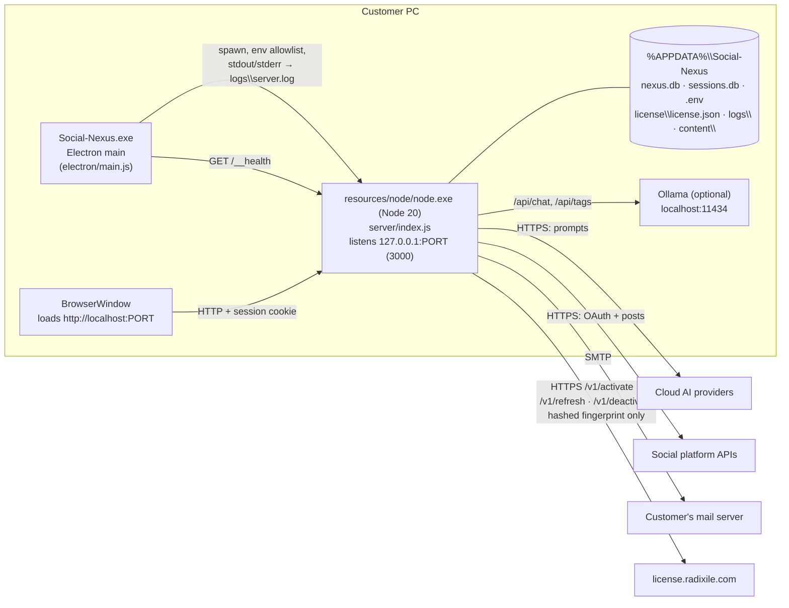
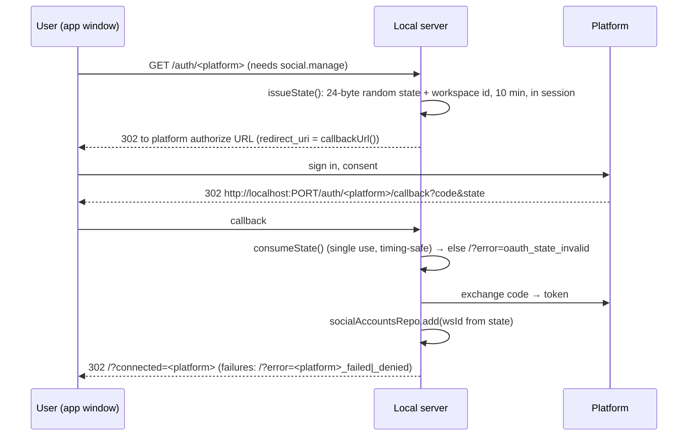
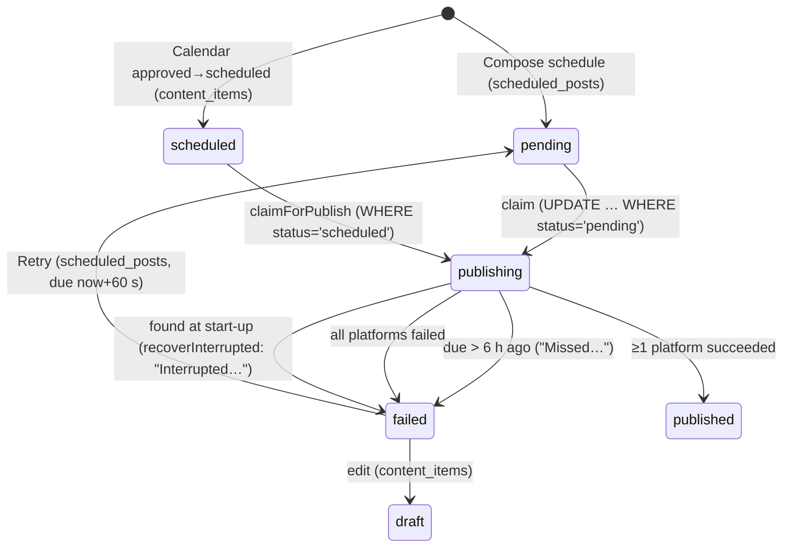
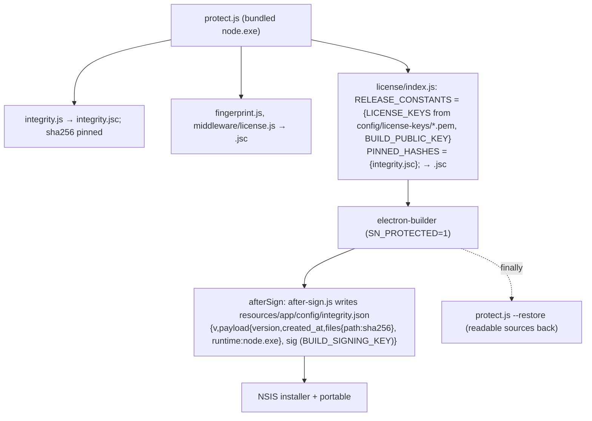

# Social-Nexus Technical Support & Operations Guide

**Audience:** Radixile developers, L2/L3 support, release managers · **Internal** · App version 2.1.0 (`package.json`), licence server 1.0.0 · October 2026

| Related document | Use |
|---|---|
| [`support-handbook.md`](support-handbook.md) | L1 front-line handbook: scripted replies, admin-panel basics, error codes. **Read it first; this guide does not repeat it.** |
| [`runbooks.md`](runbooks.md) | Step-by-step L2/L3 procedures (symptom → checks → fix → escalate) |
| [`../help/user-guide.md`](../help/user-guide.md), [`../help/connect-social-accounts.md`](../help/connect-social-accounts.md), [`../help/privacy-and-data.md`](../help/privacy-and-data.md) | Customer-facing help (also in the app as `public/help.html`) |
| `docs/architecture/*.md` | Design proposals. **Where they disagree with the code, the code wins** (see §15) |
| `README.md` in the licence server repository (`license-server`, separate repo) | Licence server deploy notes |

Rule for this guide: every command, path, variable, table and endpoint below exists in the code at the time of writing. Items that exist only in the architecture docs are marked **(planned)**.

**Where L1 escalates to you** (handbook §9): `SERVER_ERROR` / licence server down, `payments_mode = mock` in production, payment captured with no licence, signature errors, "Checking your licence…" that never ends, `BAD_FINGERPRINT` that persists, "modified" on a copy downloaded from radixile.com, reproducible app bugs, startup failures with a log. Each has a runbook.

---

## 1. System overview

### 1.1 Components

| Component | Code | Runs where |
|---|---|---|
| Electron shell (window, tray, splash, single-instance lock, data-folder migration, server supervisor) | `electron/main.js`, `electron/splash.html` | Customer PC |
| Local API + SPA server (Express 4) | `server/index.js`, `routes/*`, `services/*`, `repos/*`, `middleware/*`, `public/*` | Customer PC, child process on **bundled** `node.exe` |
| Local database (Knex; SQLite default, Postgres optional) | `config/db.js`, `knexfile.js`, `db/migrations/*` | Customer PC (or customer's Postgres) |
| Scheduler (node-cron, every minute) | `services/scheduler.js` | Inside the local server |
| Licence client | `services/license/index.js`, `services/license/fingerprint.js`, `middleware/license.js`, `routes/license.js`, `services/integrity.js` | Inside the local server |
| Licence / payment server | separate repo `license-server`: `src/*` | Radixile host, `https://license.radixile.com` |
| Release tooling | `build/build-win.ps1`, `build/installer.nsh`, `scripts/release/{protect,after-sign,gen-build-key}.js`, `scripts/gen-keys.js` (licence server repo) | Build machine |

### 1.2 Process model



Start-up sequence (`electron/main.js`):

1. `app.setPath('userData', %APPDATA%\Social-Nexus)`; single-instance lock (a second launch just focuses the window).
2. `migrateLegacyDataDir()` — one-time copy of `%APPDATA%\NEXUS` (see runbook R15).
3. Windows checks: Windows < 10 is fatal; build < 18362, free RAM < 0.5 GB, free disk < 0.5 GB are warnings.
4. Port check on `127.0.0.1:PORT`. If busy: "Port N In Use" → **Try to Connect** waits 5 s for `/__health` with `app: "social-nexus"`; anything else quits.
5. `findNodeExe()` — packaged: **only** the bundled `node.exe` (candidates `<exeDir>\resources\node\node.exe`, `<resourcesPath>\node\node.exe`, `<exeDir>\node\node.exe`). Dev also searches PATH, `C:\Program Files\nodejs`, nvm.
6. `prepareDataDir()` — creates `content\`; on first run copies `.env.example` → `.env` with a random `SESSION_SECRET` and `CONTENT_FOLDER=<data dir>/content`.
7. Spawn `node.exe server/index.js` (cwd = app folder, `windowsHide`). Splash until `/__health` answers (40 s timeout). On failure, the dialog shows the last 5 stderr lines + log folder.
8. Server: `knex.migrate.latest()` → `runLegacyMigration()` → listen on `HOST` (default `127.0.0.1`) → `scheduler.start()` → `license.start()`.
9. Main window, tray, `powerSaveBlocker('prevent-app-suspension')`. Closing the window hides to tray; **Quit** is tray → "Quit Social-Nexus".
10. If the server exits after start-up with a non-zero code: one automatic restart after 1.5 s; a second crash shows **Restart / Open log folder / Quit**.

Environment passed to the server (`startServer`): `PORT`, `NEXUS_DATA_DIR`, `DOTENV_CONFIG_PATH=<data>\.env`, `NODE_ENV=production`, `ELECTRON=true`, `NEXUS_NO_BROWSER=true`. **Packaged builds drop every other inherited variable** except `SYSTEMROOT, WINDIR, SYSTEMDRIVE, TEMP, TMP, USERPROFILE, USERNAME, USERDOMAIN, COMPUTERNAME, APPDATA, LOCALAPPDATA, PROGRAMDATA, HOMEDRIVE, HOMEPATH, PATHEXT, COMSPEC, NUMBER_OF_PROCESSORS, PROCESSOR_ARCHITECTURE, OS, LANG, TZ, HTTP_PROXY, HTTPS_PROXY, NO_PROXY`, and `PATH` is reset to `System32;Windows`. So `NODE_OPTIONS`, `LICENSE_*` etc. set in the user's environment never reach the server. **`.env` is still read** by `dotenv` (it does not override variables already set, so `PORT`, `NODE_ENV`, `NEXUS_DATA_DIR` in `.env` are ignored under Electron).

Help: links to `/help.html` open in a separate sandboxed window (1100×820); other external links open in the system browser. The tray item "Help & Documentation" opens it in the system browser.

### 1.3 Where data lives on the customer PC

| What | Path | Notes |
|---|---|---|
| Data root | `%APPDATA%\Social-Nexus` | Set explicitly in `electron/main.js`; installer creates it for the **current** user (`SetShellVarContext current`) |
| Main database | `nexus.db` (+ `nexus.db-wal`, `nexus.db-shm`) | SQLite, WAL mode, FKs on. Holds users, workspaces, posts, **OAuth tokens**, **per-user AI keys** (plain text, see §13) |
| Sessions | `sessions.db` | `connect-sqlite3`; 7-day cookie. Postgres mode uses table created by `connect-pg-simple` |
| Settings / shared secrets | `.env` | `SESSION_SECRET`, platform client IDs/secrets, admin AI keys, SMTP password (plain text) |
| Licence store | `license\license.json` | `{ device_id, file, last_time, last_error, revoked, revoked_lic }`, written atomically, mode 0600 |
| Content folder | `content\` (value of `CONTENT_FOLDER`) | Read by `/api/local/files`, `/api/local/read`, CSV import (`schedule.csv` default) |
| Logs | `logs\server.log`, `server.1.log`, `server.2.log` | Rotated at 2 MB when the app starts, 3 files; ISO UTC timestamps; `ERR` prefix = stderr |
| Markers | `.first_run_done`, `.migrated_from_nexus` | |
| Legacy backup | `%APPDATA%\NEXUS.migrated-YYYY-MM-DD` | Left by the one-time migration; user is offered deletion |
| Install folder | per-user install: electron-builder default under `%LOCALAPPDATA%\Programs\` (user may change it) | `resources\app\` (asar off), `resources\node\node.exe`, `resources\build\icon.*`. **The app never writes here** — integrity check depends on it |

Not stored on disk: the hardware fingerprint (recomputed each start, cached in memory only, so a copied data folder can't carry it).

### 1.4 What leaves the PC

| Destination | What | When |
|---|---|---|
| `license.radixile.com` | `device_id` (random UUID), 4 HMAC-SHA256 hashes (`machine, board, disk, cpu`, salt `social-nexus/fingerprint/v1`), device label (default "My computer"), app version, licence key or coupon, email/name (coupons) | Activate, refresh (due every `refresh_days`, checked every 6 h), deactivate |
| AI providers (Gemini, Groq, OpenRouter, Mistral, Anthropic, OpenAI/Stability/Luma/Runway for media) | Prompt text, brand-kit fields, the user's key | On each AI action |
| Social APIs (LinkedIn, Meta Graph v18.0, Pinterest v5, X API v2, Google, TikTok) | OAuth exchanges, post text, image URL | Connect, refresh, publish |
| Customer's SMTP server | Campaign mail | Email send |
| Ollama | Prompts | Local only (`OLLAMA_BASE_URL`, default `http://localhost:11434`) |

Never sent to Radixile: posts, social tokens, AI keys, `.env`, the database, logs (unless the customer emails them).

---

## 2. Tech stack

| Layer | Version (installed) | Notes |
|---|---|---|
| Electron | 35.7.5 (`^35.0.0`) | Windows 10 1903+ |
| electron-builder | 26.8.1 | NSIS + portable x64 |
| Server runtime | **bundled `resources/node/node.exe` v20.19.2** | Not Electron's Node |
| Express | 4.22.x + `express-async-errors`, `express-session` | |
| Knex | 3.2.x; drivers `sqlite3` 5.1.7 (used by Knex), `pg` 8.x | `better-sqlite3` 11.3.0 is only used by the legacy `services/database.js`, which is excluded from the package (`!services/database.js`) but still ABI-checked by the build |
| Scheduler | node-cron 3 | |
| AI SDKs | `@google/generative-ai`, `@anthropic-ai/sdk`, axios for the rest | |
| Mail | nodemailer 6 | |
| Release protection | bytenode 1.7.0 | |
| Tests | jest 29, supertest | |
| Licence server | Node ≥ 20, Express 4, Knex 3, `pg` (prod) / `sqlite3` (dev), bcryptjs, nodemailer | |

**Why `asar: false`:** the server runs as a separate `node.exe` process, which cannot read files from inside an asar archive; `services/integrity.js` hashes the real files under `resources/app`; and bytenode `.jsc` files are loaded by path. `npmRebuild: false` is set so electron-builder does **not** rebuild native modules for Electron's ABI.

**Native module / ABI rule:** `sqlite3` and `better-sqlite3` are loaded by the bundled Node 20, so they must be compiled for Node 20's ABI — never with `@electron/rebuild` for the packaged app. `build-win.ps1` fails if the build machine's Node major version differs from `node.exe`'s, tries `npm rebuild better-sqlite3 sqlite3 --runtime=node --target=<bundled version> --dist-url=https://nodejs.org/dist`, and re-tests. Bytecode (`.jsc`) is V8-version specific, so `protect.js` must run under the bundled `node.exe` (the build script does this).

---

## 3. Configuration reference

### 3.1 Desktop app (`.env` in `%APPDATA%\Social-Nexus`, or process env in dev)

"Set by": **E** = Electron at spawn, **I** = installer/first run, **A** = admin through the UI (written by `writeEnvValue` in `routes/config.js` or `setEnvValues` in `routes/ollama.js`), **D** = developer only.

| Variable | Purpose | Default | Set by | Release build |
|---|---|---|---|---|
| `PORT` | Server port; also the port in callback URLs | `3000` | E (from Electron's own env) | `.env` value ignored under Electron |
| `HOST` | Listen address | `127.0.0.1` | D | Honoured if put in `.env` — **never set to 0.0.0.0** (exposes the API to the LAN) |
| `NEXUS_DATA_DIR` | Data root | `../data` in dev | E | |
| `DOTENV_CONFIG_PATH` | `.env` location | `./.env` in dev | E | |
| `NODE_ENV` | `production` requires `SESSION_SECRET`; hides error details | — | E (`production`) | |
| `ELECTRON`, `NEXUS_NO_BROWSER` | Don't auto-open a browser | — | E | |
| `SESSION_SECRET` | Session cookie signing | random 32 bytes | I | Server exits if missing in production |
| `DB_CLIENT` | `sqlite` or `pg` | `sqlite` | D/A (manual `.env` edit) | Honoured |
| `DATABASE_URL` | Postgres URL (required when `DB_CLIENT=pg`) | — | D/A | Honoured |
| `CONTENT_FOLDER` | Local content folder | `<data>/content` (I); route fallback `D:/social` | I, A | |
| `APP_URL` | Base of invite links | request host | D | |
| `OLLAMA_ENABLED` | Ollama in the auto chain (anything but `false` = on) | `true` | A | |
| `OLLAMA_BASE_URL` | Ollama URL | `http://localhost:11434` | A | |
| `OLLAMA_MODEL` | Default local model | `llama3.2` | A | |
| `DEFAULT_TEXT_MODEL` | Default model in the generate UI | `ollama` | A | |
| `GOOGLE_AI_KEY`, `ANTHROPIC_API_KEY`, `GROQ_API_KEY`, `OPENROUTER_API_KEY`, `MISTRAL_API_KEY`, `STABILITY_API_KEY`, `OPENAI_API_KEY`, `LUMA_API_KEY`, `RUNWAY_API_KEY` | Shared AI keys — **used only for users with `role = admin`** (`injectUserKeys`) | empty | A (Google/Anthropic via `/api/config/ai-keys`; others manual) | |
| `GEMINI_MODEL` | Gemini text model | `gemini-flash-latest` | D | |
| `GROQ_MODEL` | | `llama-3.3-70b-versatile` | D | |
| `OPENROUTER_MODEL` | | `meta-llama/llama-3.1-8b-instruct:free` | D | |
| `MISTRAL_MODEL` | | `mistral-small-latest` | D | |
| `ANTHROPIC_MODEL` | | `claude-opus-5-5` | D | |
| `OPENAI_IMAGE_MODEL` | | `gpt-image-1` | D | |
| `GEMINI_IMAGE_MODEL` | | `gemini-2.5-flash-image` | D | |
| `LINKEDIN_CLIENT_ID/SECRET`, `FACEBOOK_APP_ID/SECRET`, `PINTEREST_APP_ID/SECRET`, `TWITTER_API_KEY/SECRET`, `TWITTER_ACCESS_TOKEN/SECRET`, `GOOGLE_OAUTH_CLIENT_ID/SECRET`, `TIKTOK_CLIENT_KEY/SECRET` | Platform app credentials (one set per install) | empty | A (`POST /api/config/platforms/:platform`) | |
| `*_CALLBACK_URL` (`LINKEDIN`, `FACEBOOK`, `PINTEREST`, `TWITTER`, `GOOGLE`, `TIKTOK`) | Custom callback | derived | A | **Ignored** if it points at `localhost`/`127.0.0.1` (§6.2) |
| `SMTP_HOST`, `SMTP_PORT` (587), `SMTP_SECURE` (`true`/other), `SMTP_USER`, `SMTP_PASS`, `SMTP_FROM`, `SMTP_FROM_NAME` | Campaign mail (install-wide) | from `.env.example` | A (`POST /api/config/smtp`) | |
| `LICENSE_SERVER_URL` | Licence server | `https://license.radixile.com` | D | **Ignored** (hard-wired) |
| `LICENSE_PUBLIC_KEY_PATH`, `LICENSE_KEY_ID` (`k1`) | Extra dev public key | — | D | **Ignored** (keys baked in) |
| `SN_PROTECTED` | Build only: tells `after-sign.js` to write the manifest | — | build script | — |
| `BUILD_SIGNING_KEY` | Build only: Ed25519 private key (PEM or base64 PEM) to sign the manifest | — | release manager | — |
| `CSC_LINK`, `WIN_CSC_LINK`, `CSC_KEY_PASSWORD` | Build only: electron-builder code signing | — | release manager | — |
| `PG_TEST_URL` | Tests: run the DB tests on Postgres | sqlite memory | CI | — |

Install-wide settings in the database (`platform_config`, via `/admin/config`): `registration_mode` (`open` / `invite` / `closed`, default `open`), `app_name`, `max_users`, `tenancy_migrated`.

### 3.2 Licence server (its own repo: `.env` or host secrets; path override `DOTENV_CONFIG_PATH`)

| Variable | Purpose | Default | Production rule (`assertProductionConfig`) |
|---|---|---|---|
| `NODE_ENV` | `production` enables the checks below, secure cookie | — | |
| `PORT` | Listen port | `4100` | |
| `PUBLIC_URL` | Absolute links (invoice URL in email, `buy_url`) | request host | Set it |
| `DATABASE_URL` | Postgres | SQLite file | **Required** |
| `LICENSE_DB` | Dev SQLite path, or `memory` | `license-server/data/license.db` | — |
| `LICENSE_PRIVATE_KEY` | Ed25519 signing key (PEM or base64 PEM) | dev key auto-created in `license-server/keys/` | **Required** |
| `LICENSE_KEYS_DIR` | Dev key folder | `license-server/keys` | — |
| `LICENSE_KEY_ID` | `kid` written into every file | `k1` | Change only when rotating (runbook R18) |
| `LICENSE_PEPPER` | HMAC pepper for key/coupon hashes, invoice/checkout tokens, order-key encryption | `dev-pepper-change-me` | **≥ 32 chars. Never change after launch** |
| `ADMIN_SESSION_SECRET` | Admin cookie HMAC | dev value | **≥ 32 chars** |
| `ADMIN_EMAIL`, `ADMIN_PASSWORD` | First owner, only when `admins` is empty | — | |
| `RAZORPAY_KEY_ID`, `RAZORPAY_KEY_SECRET` | Razorpay API | — | Required unless mock allowed |
| `RAZORPAY_WEBHOOK_SECRET` | Webhook HMAC | — | **Required** in `razorpay` mode |
| `PAYMENTS_MODE` | `mock` / `razorpay` | `razorpay` if both keys set, else `mock` | `mock` refused unless `ALLOW_MOCK_PAYMENTS=true` |
| `ALLOW_MOCK_PAYMENTS` | Test servers only | — | |
| `SMTP_HOST`, `SMTP_PORT` (587), `SMTP_SECURE`, `SMTP_USER`, `SMTP_PASS`, `MAIL_FROM` | Licence-key + invoice email | not sent | |

Server settings table (`settings`, editable by owner in Admin → Settings): `lease_days` 30, `refresh_days` 7, `subscription_grace_days` 7, `coupon_machine_cooldown_days` **90** (seed default), `ip_retention_days` 90, `company_name`, `company_gstin`, `company_address`, `company_state_code`, `support_email`, `invoice_prefix` `SNX`. `invoice_counter` is seeded but invoice numbers come from the `invoices.id`.

---

## 4. Database (desktop)

### 4.1 Engines

`config/db.js`: `DB_CLIENT=sqlite` (default) → `sqlite3` driver, file `<NEXUS_DATA_DIR>/nexus.db`, `PRAGMA journal_mode=WAL; foreign_keys=ON` per connection. `DB_CLIENT=pg` → `DATABASE_URL`, pool 2–10. Migrations run automatically at every server start; a migration error stops start-up (`[DB] Migration error:` in the log, shown in the startup dialog).

Dev commands: `npm run migrate` (`knex migrate:latest` via `knexfile.js`), `npm run migrate:make <name>`.

### 4.2 Migrations (`db/migrations`)

| File | Creates |
|---|---|
| `20260601000001_core_tables.js` | `users, user_settings, invite_codes, platform_config, posts, scheduled_posts, history, analytics, apps, brand_kit, templates, email_subscribers, email_campaigns, seo_keywords, utm_links` (each guarded by `hasTable`) |
| `20260606000001_tenancy_core.js` | `organizations, org_members, workspaces, memberships, invitations, social_accounts`; adds `workspace_id` to the data tables |
| `20260607000001_content_items.js` | `content_items, content_item_comments` |
| `20260830000001_free_model_keys.js` | `user_settings.groq_key, openrouter_key, mistral_key, language_pref` |

After migrations, `services/legacyMigration.js` runs once (guard `platform_config.tenancy_migrated='1'`): creates "My Organization"/"My Workspace", adds every user as `manager`, copies a legacy `tokens` table into `social_accounts`, stamps `workspace_id` on old rows.

### 4.3 Key tables

| Table | Key columns | Notes |
|---|---|---|
| `users` | `email` (unique), `password_hash` (bcrypt), `role` (`admin`/`user`), `status`, `last_active` | First registered user becomes `admin` |
| `user_settings` | `user_id` PK; `google_ai_key, anthropic_key, groq_key, openrouter_key, mistral_key, stability_key, openai_key, luma_key, runway_key, ollama_enabled, ollama_model, ollama_url, default_text_model, language_pref` | Per-user AI keys, **plain text** |
| `organizations` / `org_members` | `owner_user_id`; `role` owner/admin | Default org per user ("<name>'s Org") |
| `workspaces` | `org_id`, `name`, `slug` (unique per org), `timezone` (default workspace: `Asia/Kolkata`) | One per brand/client |
| `memberships` | `user_id, workspace_id` unique, `role` manager/creator/reviewer/client/analyst | RBAC (§5) |
| `invitations` | `email`, `role`, `token` unique, `expires_at`, `accepted_at` | Bound to the invited email |
| `social_accounts` | `workspace_id, platform, external_id` unique; `access_token, refresh_token, expires_at, page_id, page_token, ig_account_id, board_id, profile_json` | **Tokens plain text.** X stores the OAuth1 token secret in `refresh_token` |
| `content_items` | `status` draft→in_review→approved→scheduled→publishing→published/failed; `scheduled_at`, `social_account_ids` (JSON), `error_message` | Calendar workflow |
| `content_item_comments` | | |
| `scheduled_posts` | `status` pending→publishing→published/failed; `platforms` (JSON), `result` (JSON) | Compose scheduling (legacy path, still active) |
| `posts`, `history`, `analytics` | Published post history, AI history | |
| `email_subscribers`, `email_campaigns` | campaign `status` draft/sending/sent/failed (claimed before sending) | Per workspace |
| `platform_config` | key/value install settings | |

### 4.4 Backup / restore

There is no built-in backup feature yet (`services/backup/` is **(planned)**). Procedure: quit from the tray (so WAL is checkpointed and files are closed), then copy the whole `%APPDATA%\Social-Nexus` folder. Restore = quit, replace the folder, start. The licence will need re-activation on a different PC (fingerprint). Runbook R14.

### 4.5 Postgres

Set `DB_CLIENT=pg` and `DATABASE_URL=postgres://…` in `%APPDATA%\Social-Nexus\.env`, restart. Migrations create the schema; sessions move to Postgres (`connect-pg-simple`, `createTableIfMissing`). **There is no SQLite → Postgres data copy tool**; switching starts with an empty database. The edition limit `team_mode` is not enforced by the app code today. Runbook R16.

---

## 5. Auth, roles, permissions, tenancy

**Install level** (`users.role`): `admin` (first account) or `user`. Admin-only: `/admin/*` (users, invite codes, registration mode, stats), `/api/config/*` writes (platform credentials, shared AI keys, SMTP, content folder, Ollama enable/pull), `/ollama/select|pull` (open before the first account exists), all licence changes (`/api/license/activate|refresh|deactivate|offline-request|import`). `GET /api/license` is open to any logged-in user.

Sessions: `express-session`, cookie `httpOnly`, `sameSite=lax`, 7 days, store `sessions.db`. Passwords bcrypt (cost 10), minimum 6 characters. Registration is subject to `registration_mode` and the edition `users` limit (whole install).

**Workspace level** (`services/rbac.js` — single source of truth):

| Permission | manager | creator | reviewer | client | analyst |
|---|:-:|:-:|:-:|:-:|:-:|
| `social.manage` (connect/disconnect, page/board pick) | ✅ | | | | |
| `members.manage` (members, invitations) | ✅ | | | | |
| `content.create` | ✅ | ✅ | | | |
| `content.edit` | ✅ | ✅ | | | |
| `content.submit` | ✅ | ✅ | | | |
| `content.approve` | ✅ | | ✅ | ✅ | |
| `content.comment` | ✅ | | ✅ | ✅ | |
| `content.publish` (post now, schedule, retry, CSV import, email send/delete subscriber) | ✅ | | | | |
| `content.schedule` (approved↔scheduled) | ✅ | | | | |
| `content.view` | ✅ | ✅ | ✅ | ✅ | ✅ |
| `analytics.view` | ✅ | ✅ | ✅ | ✅ | ✅ |

Content transitions (`routes/content.js`): `draft→in_review` submit · `in_review→draft|approved` approve · `approved→draft` approve · `approved→scheduled` and `scheduled→approved` schedule. Editing a `failed` item resets it to `draft`. Only `draft`/`failed` can be deleted.

**Tenancy rules** (`middleware/tenancy.js`): the active workspace comes from `session.activeWorkspaceId`, else header `x-workspace-id`, else route param, else the user's first membership (creating a default org/workspace if none — single-flight per user in `services/workspaceHelper.js`). Every request checks membership (`403 Not a member of this workspace`). `POST /session/active-workspace` only switches to a workspace the user belongs to. Repos filter by `workspace_id`; the scheduler only uses `social_accounts` of the item's own workspace. Creating workspaces needs org owner/admin and is limited by the edition `workspaces` count **for the whole install**. Invitations can only be accepted by the account whose email matches.

---

## 6. Social platform integrations

### 6.1 OAuth flow



X/Twitter uses OAuth 1.0a (request token in session, no `state`; attaches to the current active workspace). Missing credentials redirect to `/?error=not_configured&platform=…`; no permission → `/?error=not_allowed`.

Other endpoints: `GET /auth/status`, `POST /auth/refresh/:platform` (live check; Facebook re-reads Pages and Instagram), `POST /auth/disconnect/:platform` (Facebook also removes Instagram; Google removes YouTube + Business), `POST /auth/manual-token/:platform` (Facebook Graph token paste). Page/board pickers: `GET/POST /api/config/facebook/pages|set-page`, `GET/POST /api/config/pinterest/boards|set-board`. Setup guide text: `services/platforms/guides.js`, served on `GET /api/config/platforms`.

### 6.2 Callback URLs (`services/platforms/callback.js`)

`http://<host>:<PORT>/auth/<path>/callback`, PORT = the running port (default 3000). A `*_CALLBACK_URL` in `.env` is used **only** if it does not point at `localhost`/`127.0.0.1`.

| Platform | Host | Path | Default URL |
|---|---|---|---|
| LinkedIn | localhost | `linkedin` | `http://localhost:3000/auth/linkedin/callback` |
| Facebook + Instagram | localhost | `facebook` | `http://localhost:3000/auth/facebook/callback` |
| Pinterest | localhost | `pinterest` | `http://localhost:3000/auth/pinterest/callback` |
| X / Twitter | **127.0.0.1** | `twitter` | `http://127.0.0.1:3000/auth/twitter/callback` |
| Google (YouTube, Business Profile) | localhost | `google` | `http://localhost:3000/auth/google/callback` |
| TikTok | localhost | `tiktok` | `http://localhost:3000/auth/tiktok/callback` |

If a customer changes the port, every portal's redirect URI must be re-registered.

### 6.3 Scopes and status

| Platform | Scopes requested | Status (guides.js) | Known limits |
|---|---|---|---|
| LinkedIn | `openid profile w_member_social` (OIDC, `/v2/userinfo`, posts via `/v2/ugcPosts`) | ready | Personal profile only; company Pages need Community Management API approval |
| Facebook | `public_profile,email,pages_show_list,pages_read_engagement,pages_manage_posts,instagram_basic,instagram_content_publish,business_management` (Graph v18.0) | ready | Needs a selected Page; Development-mode apps work only for app admins/testers; others need **Meta App Review** |
| Instagram | via Facebook | ready | Business/Creator account linked to the Page; **image URL required** |
| Pinterest | `boards:read,pins:write,user_accounts:read` | ready | New apps have **Trial access** (pins may be visible only to the owner until Standard access); board must be selected; image needed |
| X / Twitter | OAuth 1.0a, `POST /2/tweets` | limited | Customer's **X API plan must allow posting** (403 otherwise); text only, truncated to 280; image dropped |
| Google Business | `business.manage` (+ profile/email/YouTube scopes) | limited | Needs Google's **Business Profile API access approval**; posts to the first location; Testing-mode OAuth apps expire refresh tokens after 7 days |
| YouTube | `youtube.force-ssl`, `youtube.upload` | **unavailable** | `postToYouTube()` always throws: no public Community-post API |
| TikTok | `user.info.basic,video.publish,video.upload` | **unavailable** | Needs public https redirect + audited app; posts sent as `PUBLIC_TO_EVERYONE`, which unaudited apps can't do; video URL required |

### 6.4 Publish error messages → meaning → fix

`services/social.js` `postToPlatform()` normalises HTTP errors; these strings appear in post results, `scheduled_posts.result`, `content_items.error_message` and the log (`[Scheduler] … failed on <platform>:`).

| Message (prefix) | Meaning | Fix |
|---|---|---|
| `<Platform> rejected the connection (401/403) — the login has expired or lacks permission. Reconnect…` | Token expired/revoked, scope missing, or (X) plan without write access, (Google) API not approved | Disconnect → Connect accepting all permissions; check app review / plan; Retry |
| `<Platform> rate limit reached` | 429 | Wait; reduce frequency |
| `<Platform> is having problems (5xx)` | Platform outage | Retry later |
| `<Platform> error <status>: <api message>` | Other 4xx (e.g. Pinterest 400 with no board) | Read the API message |
| `Token expired or invalid. Reconnect Facebook…` | Graph code 190 | Reconnect |
| `Missing permission: pages_manage_posts…` | Graph code 200 | Reconnect with the permission; App Review for non-testers |
| `App permission denied…` | Graph code 10 | Enable `pages_manage_posts` on the Meta app |
| `Facebook Page token missing…` / `No Facebook Page selected…` | No page chosen | "Select Facebook Page" (manager) |
| `Instagram requires an image URL…` | Text-only IG post | Add a public https image |
| `TikTok requires a video URL…` / `Posting text or images to YouTube is not possible…` | Platform unavailable | Expected |
| `No Google Business locations found…` | Account has no locations / API not approved | Check Business Profile |
| `Not connected` / `Account not found` / `<platform> is not connected` | No `social_accounts` row in this workspace | Connect in the right workspace |
| `Missed: it was due …` | Scheduler §8 | Retry if still relevant |
| `Interrupted while publishing…` | Crash/restart mid-publish | Check platform first, then Retry |
| OAuth redirects `/?error=oauth_state_invalid` | State expired (>10 min), session lost, or callback opened in another browser | Start Connect again inside the app window |
| `/?error=<platform>_failed` | Token exchange failed; detail in log `[Auth] <Platform> error:` | Usually wrong secret or redirect URI mismatch |

---

## 7. AI providers

`services/aiHelper.js` `aiGenerate()`. Keys come from the request (`middleware/auth.js` `injectUserKeys`): the user's `user_settings`, plus `.env` shared keys **only when the user is `admin`**. Non-admins must add their own keys (user menu → My API Keys, `POST /users/settings`) or use Ollama.

**Explicit model** (`body.model`, e.g. `ollama:llama3.2`, `gemini`, `claude`, `groq[:model]`, `openrouter[:model]`, `mistral[:model]`): that provider only, no fallback; errors prefixed `Ollama:`, `Gemini:` etc.

**Auto chain** (no model): 1 Ollama (if enabled **and** the model is present) → 2 Gemini → 3 Groq → 4 OpenRouter → 5 Mistral → 6 Anthropic. Each configured provider that fails adds a line to `All configured AI providers failed:`; with nothing configured the error is `No AI provider available…`.

| Provider | Endpoint | Timeout | Retry |
|---|---|---|---|
| Ollama | `POST {base}/api/chat`, `keep_alive 30m`, `num_predict ≤ 1024`; presence check `GET /api/tags` (3 s) | 180 s | — |
| Gemini | SDK, `apiVersion v1beta` | 30 s | once on 429/503 after 2 s |
| Groq / OpenRouter / Mistral | OpenAI-style chat completions | 30 s | — |
| Anthropic | SDK, `max_tokens ≥ 8000`, `effort: low`, text blocks only | 120 s | — |

**Ollama queue:** `OLLAMA_MAX_CONCURRENT = 2`; further requests wait in an in-memory FIFO. Log: `[AI] Using Ollama (<model>) [queue: N]`. First request after load/idle ≈ 30 s (model load). `[Ollama] Running but model "<m>" not found. Available: …` means pull the model. Setup routes: `GET /ollama/status`, `GET /ollama/recommend` (<8 GB RAM → `llama3.2:1b`, else `llama3.2:3b`), `POST /ollama/select`, `POST /ollama/pull` (streamed); `/api/config/ollama/status|enable|pull`.

Ollama on/off: per-user `user_settings.ollama_enabled` is only applied when true; otherwise the `.env` `OLLAMA_ENABLED` decides (finding F51).

**Typical errors** (`shortReason()`):

| Text | Cause | Action |
|---|---|---|
| `busy right now (503)` | Provider overloaded (Gemini free tier often) | Wait / other model |
| `rate limit reached (429)` | Free quota or per-minute limit | Wait, second provider key |
| `no reply within 30 seconds (timed out)` | Network/proxy or slow provider | Check proxy (`HTTPS_PROXY` passes the allowlist) |
| `API key rejected — check it in Settings → My API Keys` | 401/403 / `API_KEY_INVALID` | Re-enter key |
| `… model … not found` / 404 | Model retired | Gemini uses alias `gemini-flash-latest`; others: set `*_MODEL` (dev) or pick another model |
| `Ollama: not running on this computer…` | `ECONNREFUSED` on 11434 | Start Ollama |
| `Ollama: the model "<m>" is not downloaded yet` | Running, model missing | `ollama pull <m>` |
| `Claude declined this request.` | `stop_reason: refusal` | Rephrase |
| `AI returned an unexpected format — try again` | `aiJSON` couldn't find JSON | Retry / different model |

---

## 8. Scheduler

`services/scheduler.js`, cron `* * * * *`, guarded by `isRunning` (no overlapping ticks).



- **Licence gate:** each tick first checks `license.status().can_publish`; if false nothing is processed and due items **stay** `pending`/`scheduled`.
- **Claim before publish:** the row is moved to `publishing` with a conditional update; only the winner publishes, so no double posts across overlapping runs.
- **Missed rule:** `MISSED_AFTER = 6 h`. A claimed item whose `scheduled_at` is more than 6 h in the past is marked `failed` with `Missed: it was due <IST time> but Social-Nexus wasn't running or wasn't licensed then. Use Retry to post it now.` Less than 6 h late → published normally.
- **Retries:** none automatic. Compose: `POST /api/posts/scheduled/:id/retry` (needs `content.publish` + licence); failed list `GET /api/posts/scheduled/failed` (last 14 days). Calendar: edit → draft → approve → schedule.
- **Interrupted recovery:** at start, every `publishing` row → `failed` with `Interrupted while publishing…` (never auto-reposted, because it may have reached the platform).
- **Partial success** counts as `published` (finding D8).
- `scheduled_posts` rows without `workspace_id` are skipped.
- Sleep: Electron holds `prevent-app-suspension` while running, but a PC put to sleep or shut down still misses ticks.
- Not implemented: recurring posts (`routes/tools.js /recurring` is in-memory, never executed), Autopilot, SEO automation **(planned)**.

---

## 9. Licensing

### 9.1 Licence file (v2)

Stored at `%APPDATA%\Social-Nexus\license\license.json` → `file`:

```json
{ "v": 2, "kid": "k1", "payload": "<base64 of JSON bytes>", "sig": "<base64 Ed25519 over the payload bytes>" }
```

Payload (`license-server/src/licensing.js` `buildFile`): `v, lic ("L-000123"), type (perpetual|subscription|coupon), edition, edition_name, licensee, device (device_id), fp {machine,board,disk,cpu hashes}, issued_at, server_time, lease_until, refresh_after, expires_at, updates_until, limits {seats, workspaces, users, autopilot_rules, seo_sites, publish, team_mode}`. All times epoch seconds. Offline import accepts either the bare file or `{ "kind": "social-nexus-license", "file": {...} }` (`.snlic`).

### 9.2 States (`services/license/index.js` `status()`)

Evaluated in this order; the first match wins:

| # | Condition | State | Message (abridged) |
|---|---|---|---|
| 1 | Integrity `modified`, or pinned `integrity.jsc` hash mismatch | `invalid` (`integrity: "modified"`) | "This copy of Social-Nexus has been modified…" |
| 2 | Release and integrity still running | `checking` | |
| 3 | No public key available | `unlicensed` | "Licensing is not configured in this build…" |
| 4 | No stored file | `unlicensed` | "Activate Social-Nexus…" |
| 5 | Signature/kid fails | `invalid` | "The licence file is damaged or was changed…" |
| 6 | Fingerprint not read yet, or partial read (fewer parts than stored) | `checking` | |
| 7 | `payload.device ≠ store.device_id` | `invalid` | "…belongs to another installation…" |
| 8 | `!sameDevice(fp, current)` | `invalid` | "…activated on a different computer…" |
| 9 | Server answered `REVOKED/SUSPENDED/DEVICE_MISMATCH` on refresh | `invalid` | server's message |
| 10 | `now < max(last_time, server_time or issued_at) − 1 day` | `offline` | "Your computer's date looks wrong…" |
| 11 | `now > expires_at (+7 days if subscription)` | `expired` | coupon / subscription text |
| 12 | `now > lease_until` | `offline` | "…needs to connect to the internet briefly…" |
| 13 | otherwise | `active` | banner if ≤14 days to `expires_at` or ≤3 days of lease |

`can_publish = active && limits.publish !== false`. Without a licence, `LIMITED = {seats 1, workspaces 1, users 1, autopilot_rules 0, seo_sites 0, publish false, team_mode false}`. Gated by licence: post now, schedule, retry, CSV import (`requirePublishLicense` → HTTP 402 `LICENSE_REQUIRED`), content `→scheduled/published`, email send, scheduler tick. Limits enforced: `users` (register, admin create user), `workspaces` (create) → 402 `LICENSE_LIMIT`.

Read the state: `GET http://localhost:3000/__health` → `{"app":"social-nexus","version":"2.1.0","licence":"<state>"}` (no login), or `GET /api/license` (logged in; full status incl. `lease_until`, `expires_at`, `last_error`, `needs_refresh`, `limits`).

### 9.3 Fingerprint and `sameDevice`

`fingerprint.js` reads (Windows) with full paths to `System32\WindowsPowerShell\v1.0\powershell.exe` (one `Get-CimInstance` call: BaseBoard serial, ComputerSystemProduct UUID, DiskDrive index 0 serial, Processor ID) and `System32\reg.exe` (MachineGuid). `machine` = MachineGuid (fallback UUID), `board` = baseboard serial (fallback UUID), `disk`, `cpu`. Junk OEM values are dropped. Last resort `machine = hostname|platform|arch|totalmem`. Each part is `HMAC-SHA256('social-nexus/fingerprint/v1', UPPER(trim(value)))`.

`isComplete` = ≥ 3 parts. `sameDevice(stored, given)` (identical on client and server): matches when at least `min(3, stored parts)` stored parts are equal; missing parts count as changed. An incomplete first read is retried after 30 s, 120 s, 300 s; refresh is skipped while incomplete so a slow PowerShell can't cost a seat.

### 9.4 Lease, refresh, grace, clock

| Rule | Value | Where |
|---|---|---|
| Refresh timer | every 6 h (+ at start); calls the server only if `now ≥ refresh_after` or state is offline/expired/invalid/checking, or forced (**Check now** = `POST /api/license/refresh`) | client |
| `refresh_after` | `now + refresh_days` (7) | server |
| `lease_until` | `now + lease_days` (30), capped at `expires_at + grace` | server |
| Subscription grace | server: `subscription_grace_days` (7); client: **hard-coded 7 days** | both |
| Coupons | no grace | both |
| Clock rollback | > 1 day earlier than the latest time seen → `offline` until fixed and refreshed | client |
| Refresh failure | network/server/expired → `last_error` stored, keeps working until `lease_until`; `REVOKED/SUSPENDED/DEVICE_MISMATCH` → `invalid` | client |
| Subscription renewal | Razorpay `subscription.charged` moves `expires_at` to `current_end` (only for `status=active` licences) | server |

### 9.5 Activation flows and endpoints

| Client (`/api/license/…`, admin only) | Server | Notes |
|---|---|---|
| `POST activate {key|coupon, email, name, device_name}` — `SNX-XXXX-XXXX` is treated as a coupon | `POST /v1/activate` (30 / 15 min per IP) | Seat check + device insert in one transaction; same PC (sameDevice) reuses its seat |
| `POST refresh` | `POST /v1/refresh` (60 / 15 min) | Updates `devices.last_seen`, `app_version`, components (self-healing); not audited |
| `POST deactivate` | `POST /v1/deactivate` (30 / 15 min) | Device must prove itself (device_id + sameDevice). Offline → error, licence kept locally |
| `POST offline-request {key}` → `activation.snreq` (`kind: social-nexus-activation-request`; keys `SNXP-`/`SNXS-` only) | `POST /offline/activate {request}` from page `/offline` → downloads `license.snlic` | Coupons rejected (`COUPON_ONLINE_ONLY`) |
| `POST import {content}` | — | `acceptFile`: verify, device adopt if sameDevice, else `DEVICE_MISMATCH` |
| — | `GET /v1/products`, `GET /v1/public-key` | Catalogue, current public PEM |

Client HTTP status mapping: `NETWORK` → 503, `SEATS_FULL` → 409 (with `devices` list), else 400.

**Transfer limit:** self-service deactivation is refused with `TRANSFER_LIMIT` when the licence already has ≥ `max(1, seats)` devices deactivated in the last 90 days. Admin-panel deactivation is not limited (but those rows count towards the next self-service check). Lowering seats (`setSeats`) deactivates the least-recently-seen devices.

### 9.6 Coupons (server)

Format `SNX-XXXX-XXXX` (alphabet `ABCDEFGHJKMNPQRSTUVWXYZ23456789`); keys `SNXP-`/`SNXS-` + 4×5. Stored as `HMAC-SHA256(LICENSE_PEPPER, normalised)`; hint = last 4. Campaign fields in code: `name, edition_code (default full), duration_days (1–3650), valid_from/valid_until (IST day bounds), max_redemptions_per_code, per_machine_once, per_email_once, note, issued_to, status (active|paused|revoked)`; 1–5000 codes per batch, returned once. Redemption order: code active → campaign active → window → email if `per_email_once` (Gmail dots/`+tags` normalised) → same code + same PC ⇒ **same licence back** → `COUPON_USED_ON_PC` → `COUPON_USED_BY_EMAIL` → `COUPON_COOLDOWN` (`coupon_machine_cooldown_days`, default 90) → atomic use (`COUPON_USED_UP`) → new `coupon` licence, 1 seat, `expires_at = now + duration_days`. Unique constraints on redemptions catch races. Revoking a campaign revokes all its licences. Support role may only **pause**; owner may resume/revoke.

### 9.7 Editions / limits

Seeded (`license-server/src/seed.js`, inserted only if missing): `individual` {seats 1, workspaces 1, users 2, autopilot 3, seo 1, publish, no team}, `agency` {5, 25, 10, −1, 10, team}, `full` {1, 25, 10, −1, 10, team}. Owner edits via `PUT /admin/api/editions/:code` (keys `seats, workspaces, users, autopilot_rules, seo_sites, publish, team_mode`; −1 = unlimited). **Each licence snapshots `limits_json` at issue**, so edition edits affect new licences only; seats live on the licence. Products are seeded with placeholder prices (paise, before GST 18%).

### 9.8 Release protection



At runtime (release): `index.jsc` checks the SHA-256 of `services/integrity.jsc` before loading it by exact path, configures it with the baked build public key, and runs the integrity check in the background: missing/unsigned manifest, bad signature, missing/changed file, or **any file under `resources/app` not in the manifest** (except `config/integrity.json`) ⇒ `modified`. `node.exe` is hashed as `runtime:node.exe` via `process.execPath`. Release builds ignore `LICENSE_SERVER_URL`, `LICENSE_PUBLIC_KEY_PATH`, `LICENSE_KEY_ID` and extra key files. A modified install still runs (view/draft/export) but is never licensed.

**Honest limits:** bytecode can be decompiled and patched with effort; `Social-Nexus.exe`/Electron files outside `resources/app` are not in the manifest; there are no Electron fuses and no code signature yet; the shell env allowlist and `.env` don't stop someone editing the bytecode. The real protection is server-side: signed, device-bound, leased licence files, seat counts and revocation.

### 9.9 Key management

| Key | Created by | Public part | Private part | Never commit |
|---|---|---|---|---|
| Licence signing key (Ed25519, `kid`) | `npm run keys` in the licence server repo (`LICENSE_KEY_ID=k2 npm run keys` for a new kid); copy `public-keys/<kid>.pem` to the app | `config/license-keys/<kid>.pem` — **commit** in the app | `LICENSE_PRIVATE_KEY` on the licence host; two offline copies | private key, `.env` |
| `LICENSE_PEPPER` | printed by `npm run keys` (first time) | — | host secret; **never rotate** (all key/coupon hashes depend on it) | |
| `ADMIN_SESSION_SECRET` | printed by `npm run keys` | — | host secret; rotating logs all admins out | |
| Build signing key (Ed25519) | `node scripts/release/gen-build-key.js` (`--force` to replace) | `config/build-public-key.pem` — **commit** | `BUILD_SIGNING_KEY` on the build machine / CI secret | private key |
| Code-signing certificate | not purchased yet | — | `CSC_LINK`/`CSC_KEY_PASSWORD` or cloud HSM | |

Ignored by `.gitignore`: `.env`, `data/`, `*.db`, `.protect-backup/`, `config/integrity.json`, `*.jsc`. **As of this writing neither `config/license-keys/k1.pem` nor `config/build-public-key.pem` exists in the repo**, so a protected build stops at the protect step until they are generated.

Rotation: runbook R18. `gen-keys.js` also prints fresh `LICENSE_PEPPER`/`ADMIN_SESSION_SECRET` values every time it runs — ignore them when rotating.

---

## 10. Licence server operations

### 10.1 Deployment (licence server repo `README.md`)

Node 20 host + Postgres behind **exactly one** HTTPS proxy (`trust proxy = 1`; rate limits use `req.ip`). `npm install`, set env (§3.2), `npm start` (`node src/server.js`). On start: production config assertion → `knex.migrate.latest()` (`src/migrations/20261025000001_init.js`, `20261026000001_hardening.js`) → seed editions/products/settings/first owner → load keys → daily IP purge. Startup failure prints `[license-server] failed to start: Refusing to start in production: - …`.

Tables: `editions, products, customers, licenses, devices, coupon_campaigns, coupon_codes, coupon_redemptions, orders, invoices, admins, settings, audit_log`.

### 10.2 Routes

| Path | Who | Purpose |
|---|---|---|
| `GET /health` | monitoring | `{ok:true, app:"social-nexus-license-server"}`; 503 if DB fails |
| `/v1/activate`, `/v1/refresh`, `/v1/deactivate`, `/v1/products`, `/v1/public-key` | app | §9.5 |
| `/buy` (`/`), `/offline`, `/privacy`, `/admin`, `/static/*`, `/config.js` | browsers | pages |
| `POST /shop/checkout` (20/15 min), `POST /shop/confirm` (30/15 min) | buy page | checkout |
| `GET /invoice/:id?t=<hmac>` | buyer | printable GST invoice |
| `POST /webhooks/razorpay` | Razorpay | raw body, `x-razorpay-signature` |
| `/admin/api/*` | admin panel | cookie `snx_admin` (12 h, HttpOnly, SameSite=Strict); writes need header `x-requested-with: social-nexus-admin`; login 10 / 15 min per IP+email |

Admin API (role): `login, logout, me (shows payments_mode), dashboard, catalog, settings GET` (support+owner); `licenses` search/detail (support+owner); `POST licenses` issue (owner); `licenses/:id/regenerate-key` (support+owner); `licenses/:id/status` (support may suspend/reactivate; only owner revokes or restores a revoked one); `extend`, `seats` (owner); `licenses/:id/devices/:deviceId/deactivate` (support+owner); `coupons` list (both), create (owner), status (support: pause only); `orders`, `audit` (both); `customers/anonymise`, `admins*`, `editions/:code`, `products/:id`, `settings PUT` (owner). Panel tabs: Dashboard, Licences, Coupons, Prices & editions, Orders, Team, Settings, Activity log.

### 10.3 Payments

- **Mode:** `payments.mode` = `PAYMENTS_MODE` or `razorpay` when both keys exist, else `mock`. Mock checkout marks paid on `mock_paid: true` — **licences for free**. Visible at `GET /admin/api/me` and `/config.js`.
- **One-time / update renewal:** `POST /orders` to Razorpay (amount incl. GST, `notes.order_id`). **Yearly:** `POST /subscriptions` with the product's `razorpay_plan_id`, `total_count: 10` (missing plan → `NOT_CONFIGURED`).
- **Confirm:** checkout token (hashed on the order) + Razorpay signature (`order_id|payment_id` or `payment_id|subscription_id`, HMAC with key secret) → `markPaid` (idempotent claim) → licence issued, key encrypted on the order (AES-256-GCM, key from pepper), invoice created → key revealed **once** then wiped; also wiped after a successful email.
- **Webhook events handled:** `payment.captured`/`order.paid` (match `razorpay_order_id` **and amount**), `subscription.activated`/`subscription.charged` (first order → paid; later charges → new `renewal_charge` order + invoice; move `expires_at`), `subscription.cancelled|completed|halted` (audit only; licence runs to `expires_at`), `refund.processed`/`payment.refunded` (full refund: purchase → licence `revoked`; renewal charge → `expires_at = now`; update renewal → `updates_until` rolled back; partial → order `refund_status=partial`, licence unchanged). Bad signature → 400; handler error → 500 (Razorpay retries); unknown events → 200.

### 10.4 GST invoices

`invoices` row per paid order with a frozen `snapshot_json` (seller from settings, buyer from checkout, SAC `997331`, CGST+SGST when buyer state = `company_state_code`, else IGST). Number `<invoice_prefix>/<FY e.g. 2026-27>/<id 5 digits>`. Link `/invoice/<orderId>?t=<first 32 chars of HMAC('invoice', id)>`; can be regenerated by anyone holding the pepper (no "resend" button yet). Fill `company_gstin`, `company_address`, `company_state_code` before the first sale. Keep invoices 8 years (README).

### 10.5 Privacy

- Stored: customer email/name/phone/company/GSTIN/address (billing on each order), hashed device parts, device label, app version, payment ids.
- Activity log IPs nulled after `ip_retention_days` (90) by the daily purge.
- Routine refreshes aren't audited; activations, admin actions, payments are.
- Erasure: `POST /admin/api/customers/anonymise {email}` (owner; panel Settings → "Anonymise a customer…"): customer email → `deleted-<id>@anonymised.invalid`, name/phone/company/address null, licensee "Anonymised customer", coupon redemption emails null, device names null. **Invoices and `orders.billing_json` are kept** (GST).

### 10.6 Backups and monitoring

| Item | Action |
|---|---|
| Postgres | Provider daily backups + PITR; test a restore before launch |
| `LICENSE_PRIVATE_KEY`, `LICENSE_PEPPER` | Two sealed offline copies each. Losing the private key = every app needs an update; losing the pepper = no existing key/coupon can be matched |
| Monitoring | Poll `GET /health` (expect 200 + `ok:true`); alert on 503 / timeout. Watch logs for `[webhook]`, `[error]`, `[mail] licence email failed`, `[purge]`. Check `payments_mode` = `razorpay` on the dashboard after each deploy |
| Logs | stdout/stderr only; errors are logged as `[where] CODE HTTP status: message` (no bodies, keys or auth headers) |

---

## 11. Build and release

### 11.1 Prerequisites

Windows x64 build machine; Node **20.x** (same major as `resources/node/node.exe`, currently v20.19.2 — node.exe is not in npm, copy an official Node 20 x64 binary there); `npm ci`; `build/icon.ico` + `build/icon.png` (git-ignored; generate with `npm run icons`); `config/license-keys/<kid>.pem`; `config/build-public-key.pem`; `BUILD_SIGNING_KEY` in the environment; optionally `CSC_LINK`/`CSC_KEY_PASSWORD`.

### 11.2 `build/build-win.ps1`

```powershell
.\build\build-win.ps1              # full: tests + protect + installer + smoke test
.\build\build-win.ps1 -DirOnly     # unpacked dist-app\win-unpacked only
.\build\build-win.ps1 -SkipTests   # internal builds only
```

| Step | Failure text | Meaning / fix |
|---|---|---|
| 1 Prerequisites | `Bundled runtime missing: resources\node\node.exe` | Copy Node 20 x64 `node.exe` |
| | `Build machine Node … and bundled … have different major versions` | Use Node 20 on the build machine |
| | `npm ci failed` | Lockfile / network |
| 2 Native modules | `Native modules still fail in the bundled runtime` | Rebuild didn't produce a Node-20 binary; clean `node_modules`, `npm ci` under Node 20 |
| 3 Tests | `Tests failed - fix before releasing` | `npx jest --forceExit --silent` failed |
| 4 Protect | `[protect] FAILED: No licence public key in config/license-keys/` | Run `npm run keys` in the licence server repo (once) and copy `public-keys/<kid>.pem` into `config/license-keys/` |
| | `config/build-public-key.pem missing` | Run `node scripts/release/gen-build-key.js` |
| | `…missing the placeholder: const …= null;` | `services/license/index.js` was left protected or edited; run `node scripts/release/protect.js --restore` |
| 5 Build | `electron-builder failed` | See electron-builder output (icons, locked `dist-app`) |
| | `No integrity manifest in the packaged app` | `afterSign` not run (check `build.afterSign`, `SN_PROTECTED`) |
| | `Integrity manifest is not signed - set BUILD_SIGNING_KEY` | Set the env var |
| 5b Smoke test | `Packaged server did not start` | Starts `win-unpacked\resources\node\node.exe server/index.js` with a temp `NEXUS_DATA_DIR`, `PORT=3987`, polls `http://127.0.0.1:3987/__health` 90 s. Native modules / missing files |
| | `The packaged app reports itself as MODIFIED` | Manifest doesn't match files (something wrote into `resources/app` after afterSign) |
| 6 Output | `UNSIGNED build - Windows will show 'Unknown publisher'` | Warning only |

The `finally` block always runs `protect.js --restore`; if a build was killed, run `node scripts/release/protect.js --restore` before committing (otherwise `services/license/index.js` etc. are stubs and `*.jsc` files lie around).

Plain `npm run dist` / `npm run dist:dir` build **unprotected** packages (integrity `dev`, keys from `config/license-keys`), for internal testing only.

### 11.3 Code signing

No certificate yet; builds are unsigned (SmartScreen "Unknown publisher"). Options and costs: `docs/architecture/licensing-and-distribution.md` §1 (recommendation: OV certificate with cloud signing; Microsoft Store MSIX as a second channel; Azure Artifact Signing not available to an Indian LLP). When available: `CSC_LINK`/`CSC_KEY_PASSWORD`, or `win.signtoolOptions` for a cloud tool. Sign before afterSign runs (electron-builder order already does this: the manifest hashes the signed exe files).

### 11.4 Versioning and installer behaviour

- Version = `package.json` `version` (shown in tray, `/__health`, error dialogs, `app_version` sent to the licence server). Artefacts: `dist-app\Social-Nexus-Setup-<version>.exe`, `dist-app\Social-Nexus-Portable-<version>.exe`. Print SHA-256 at the end of the build.
- NSIS: assisted (`oneClick: false`), install mode per-user by default with elevation allowed, install dir changeable, desktop + Start-menu shortcuts "Social-Nexus", runs after finish, EULA `LICENSE.txt`, `requestedExecutionLevel: asInvoker`.
- `customInstall`: creates `%APPDATA%\Social-Nexus\content`, removes old "NEXUS Marketing" shortcuts and the old firewall rule (no firewall rule is added).
- `customUninstall`: removes the firewall rule; **on a real uninstall (not an update)** asks "Also delete all Social-Nexus data…?" — default **No** keeps data; Yes deletes `%APPDATA%\Social-Nexus`, `%APPDATA%\NEXUS` and `NEXUS.migrated-*`.
- Upgrade = run the newer installer; data untouched; migrations run on first start.
- No auto-updater exists **(planned)**; `/v1/updates/latest` is not implemented.

### 11.5 Release smoke test (manual, after the script)

On clean Windows 10 and 11 VMs: install → first run creates `%APPDATA%\Social-Nexus` → `http://localhost:3000/__health` shows the new version and `licence` ≠ `invalid` → register → activate a test key against production (or a staging server for internal builds) → schedule a post 2 min ahead on a test account → upgrade from the previous installer (data kept) → offline launch → uninstall with **No** (data kept) and reinstall. Licensing-and-distribution §7 lists the full checklist. Runbook R19.

---

## 12. Logging and diagnostics

| Source | Where | Contents |
|---|---|---|
| Server log | `%APPDATA%\Social-Nexus\logs\server.log` (+ `.1`, `.2`) | Everything the server prints; UTC |
| Startup dialog | on screen | Last 5 stderr lines + log folder |
| Electron main console | only when run from a terminal (`npm run electron`) | `[Paths]`, `[Node]`, `[Data]` lines |
| Health | `GET http://localhost:<PORT>/__health` | app id, version, licence state |

Useful markers: `[DB] Migration error:`, `[Startup] SESSION_SECRET must be set in production.`, `[Startup] fatal`, `[Server] Unhandled error:`, `[Scheduler] Processing …`, `[Scheduler] … failed on <platform>:`, `[Scheduler] Recovery failed:`, `[Auth] <Platform> error:`, `[AI] Using …`, `[AI] … failed:`, `[Ollama] Running but model … not found`, `[Licence] could not save licence state:`, `[WorkspaceHelper] …`, `EXIT code=<n>`, `SPAWN ERROR`.

**Ask the customer for:** `server.log` (+ `server.1.log`), screenshot of the error and of Settings → 🔑 Licence, app version, Windows version, approximate time (IST). Procedure for them: handbook §8.

**Never ask for:** passwords, full API keys or client secrets, `.env`, `nexus.db`, `sessions.db`, `license\license.json` is not secret but unnecessary — licence questions are answered from the admin panel.

**Developer run:**

```powershell
npm ci
npm start                 # node server/index.js → http://localhost:3000, data in .\data, opens a browser
npm run dev               # nodemon
$env:NODE_ENV="development"; npx electron .   # Electron shell from the repo (needs NODE_ENV=development, otherwise
                                              # it looks for the app under Electron's resources folder)
npx jest                  # all tests (sqlite in memory); npm test = jest --runInBand
npx jest tests/license.client.test.js     # app ↔ licence server tests; needs ../license-server or LICENSE_SERVER_DIR (skipped otherwise)
$env:PG_TEST_URL="postgres://…"; npx jest  # DB tests on Postgres
cd ..\license-server; npm start            # separate repo; http://localhost:4100 (mock payments without Razorpay keys)
```

`npm run electron:dev` uses POSIX `NODE_ENV=development electron .`, which fails in PowerShell/cmd; use the line above. Note: the Electron shell **always** uses `%APPDATA%\Social-Nexus` as its data folder, even in dev — on a machine that also runs the installed app, both share one database. In dev the shell uses `resources\node\node.exe` if present, else a system Node. Dev data lives in `.\data\` — **don't test against it**; for UI tests point the server at a throwaway folder: set `NEXUS_DATA_DIR`, `PORT` (e.g. 3099), `NEXUS_NO_BROWSER=true`, and for licensing `LICENSE_SERVER_URL=http://127.0.0.1:4100` + `LICENSE_PUBLIC_KEY_PATH` = the dev server's `license-public.pem`; run the licence server with `LICENSE_DB`, `LICENSE_KEYS_DIR`, `PAYMENTS_MODE=mock`. `.claude/launch.json` (config `nexus-uitest` on 3099; the licence server repo has its own `license-dev` on 4100) does this via scripts in a session scratchpad folder; those scripts are machine-specific and not part of the repo.

Test suites (`tests/`): aiAssist, content (migration, repo, route), db.config, integrity, invitations integration, legacyMigration, license.client, migration.schema, phase0.security, rbac, repos.isolation, routes.workspaces, scheduler.content, social-accounts.route, tenancy.middleware, workspaceHelper. The licence server's own tests (`test/licensing.test.js`) live in its repo.

---

## 13. Security and privacy (DPDP Act)

- **Secrets at rest:** OAuth tokens (`social_accounts`), per-user AI keys (`user_settings`), shared keys, platform secrets and SMTP password (`.env`) are **plain text** on the customer PC (finding D11; DPAPI encryption **(planned)**). Protection relies on the Windows user profile. Advise customers to use a Windows account per person and disk encryption.
- **Network exposure:** server listens on `127.0.0.1` only; `cors()` is open (allow-all) and there is no Host/Origin guard yet (`middleware/hostGuard.js` **(planned)**); cookies are `SameSite=lax`. Never advise `HOST=0.0.0.0`.
- **Support must never ask for:** passwords (Social-Nexus, Windows, email, social), full API keys, Client Secrets, App Passwords, card/UPI details, `.env`, `nexus.db`, `sessions.db`. If received: tell the customer to rotate it, delete the message/attachment, note it in the ticket without the value.
- **Logs:** may contain emails, post text and platform error bodies; delete them from tickets after closure.
- **Licence server data:** see §10.5. Keys/coupons are hashes; keys are shown once.
- **Data deletion requests:** (1) Radixile side — anonymise on the licence server (runbook R23); invoices kept for GST. (2) Customer side — all app data is on their PC: uninstall and answer **Yes** to deleting data, or delete `%APPDATA%\Social-Nexus`; revoke the app in each social platform's settings; delete AI keys at providers. A single user on a shared install: `DELETE /admin/users/:id` (admin) removes the user and rows with that `user_id` in the legacy data tables.
- Secrets for Radixile infrastructure (`LICENSE_PRIVATE_KEY`, `LICENSE_PEPPER`, `ADMIN_SESSION_SECRET`, `RAZORPAY_*`, `BUILD_SIGNING_KEY`, SMTP) live only in host/CI secret stores, never in git, tickets or chat.

---

## 14. Known issues / open items

From `docs/testing/2026-10-25-ui-test-report.md` (still open after the fix round) and the code:

| ID | Item |
|---|---|
| F1, F24, F30 | Too many menu items; three editors; solo users must self-approve calendar items (R1 simple mode planned) |
| F18, F19 | Guided connect partly done (guides.js); wizard still marks setup done on any click |
| F28, F29, D10 | Compose-scheduled posts (`scheduled_posts`) don't appear on the Calendar (`content_items`); festivals only 7 days ahead |
| F8 | Template `{placeholders}` pasted literally |
| F11 | Layout breaks around 800 px width |
| F12, F14, F40 | AI keys in three places; shared `.env` keys (now admin-only) |
| F15 | `/workspaces/:id` ignores the id |
| F27 | Images by public URL only (no upload) |
| F36 | Teammates must use the same PC (loopback only) |
| F38, F39 | Email setup: no presets, no test send, values not shown again; install-wide not per workspace |
| F50 | Ollama queue: no "n ahead" indicator or cancel |
| F51 | `user_settings.ollama_enabled=false` vs `.env OLLAMA_ENABLED` disagree |
| D3, D4 | TikTok/YouTube unavailable (by design now) |
| D5 | Compose schedule picker default time in UTC shown as local |
| D6, D7 | Remaining raw/legacy messages (e.g. `Add GROQ_API_KEY`, "NEXUS" in a low-memory warning, About version) |
| D8 | X drops images; partly failed posts are marked published; CSV import skips checks |
| D9 | `CONTENT_FOLDER` route fallback `D:/social` |
| D11 | Secrets unencrypted at rest |
| R3, R5 | Autopilot and SEO automation not implemented; `routes/tools.js /recurring` in-memory and never executed |
| Ops | No auto-update, no backup/export feature, no code-signing certificate, no Electron fuses, no SQLite→Postgres migration tool, licence keys not yet generated in `config/` |
| Ops | Admin panel lacks: coupon CSV export, per-code revoke, redemption list endpoint, "resend invoice", "mark order paid" |

---

## 15. Doc/code mismatches

| # | Document says | Code does |
|---|---|---|
| 1 | Offline-desktop §5.4: server via `utilityProcess.fork`, drop node.exe | Spawns bundled `resources/node/node.exe` |
| 2 | Offline-desktop §2.3: 5 components, ≥3 of 5 with c1 or c2 required; `max_transfers` per year (3) | 4 components (`machine, board, disk, cpu`), ≥ min(3, stored) equal, none required; transfer limit = `max(1, seats)` per 90 days |
| 3 | Offline-desktop §2.4: key `SNX-` 4×5 + check char, `sha256(key)`; file `license.snlic` PEM-armoured, `state.json` MAC'd; two embedded keys | Keys `SNXP-`/`SNXS-` 4×5, coupons `SNX-` 4+4, HMAC with pepper; store `license/license.json` (plain JSON, v2 `{v,kid,payload,sig}`); all `config/license-keys/*.pem` baked in |
| 4 | Offline-desktop §2.5: clock rollback 48 h; offline licences 365-day lease; 14-day trial `/v1/trial` | Rollback 24 h; offline activation gets the normal lease; no trial endpoint |
| 5 | Licensing-and-distribution §6 & offline-desktop §5.3: `POST /v1/offline/request`, `GET /v1/updates/latest` | `POST /offline/activate`; no update endpoint |
| 6 | Licensing-and-distribution §3: coupon fields `allow_after_trial`, `stackable`; per-PC cool-down optional | Not implemented; `coupon_machine_cooldown_days` seeded **90** (handbook §4.2 and §5 say default 0/off) |
| 7 | Licensing-and-distribution §4: licence file `v:1` with `feat`; recheck every 7 days; perpetual grace 30 days | v2 with `limits`; refresh due after `refresh_days` (checked every 6 h); lease 30 days for all types, subscription grace 7 days (client hard-codes 7 regardless of server setting) |
| 8 | Licensing-and-distribution §5: Electron fuses, signed node.exe | Not implemented |
| 9 | Offline-desktop §3.1–3.3: `config.json`, `keys/dek.bin`, `db/social-nexus.db`, `media/`, `backups/`, electron-log `main.log`; DPAPI secrets; `.env` not used in packaged builds | Flat `%APPDATA%\Social-Nexus` with `nexus.db`, `.env`, `logs/server.log` (own rotation); no DEK/encryption; `.env` is the live config |
| 10 | Offline-desktop §5.4: Electron restart backoff 1/5/30 s, dialog after 3 failures | One automatic restart, dialog on the second crash |
| 11 | Licence server README step 2 (older text): `npm run keys` writes into the app | Writes `public-keys/<kid>.pem` in the licence server repo; copy it to the app's `config/license-keys/<kid>.pem` |
| 12 | Test report "still open" lists F2, F3/D1, D2 (hard-coded `localhost:3000`, retired LinkedIn scopes, X on localhost) | Fixed in code: `callback.js` derives the port, X uses 127.0.0.1, LinkedIn uses OIDC `openid profile w_member_social` — re-verify with a real app |
| 13 | Test report F50: Ollama "one request at a time" | App allows 2 concurrent Ollama requests (`OLLAMA_MAX_CONCURRENT = 2`); Ollama itself may serialise |
| 14 | Handbook §4.1: campaign **Redemptions** list (up to 500) | No admin API endpoint returns redemptions |
| 15 | Handbook §6 "Lost licence key": issue new licence + revoke old | `POST /admin/api/licenses/:id/regenerate-key` (support+owner) replaces the key on the same licence; README refers to it as "New key" |
| 16 | Handbook §3.2/§3.5 imply support issues/extends licences | Issue, extend, seats are **owner-only** in the API |
| 17 | `.env.example` comment: "Ollama … PRIMARY"; `CONTENT_FOLDER=D:/social` | Chain is Ollama first only if enabled and model present; first run rewrites `CONTENT_FOLDER` to the data folder |
| 18 | `package.json` `electron:dev` script | POSIX env syntax; doesn't work on Windows shells |
| 19 | `build/BUILD-COMMANDS.ps1` header "NEXUS v2.0" | Legacy helper; `build/build-win.ps1` is the supported release script |
